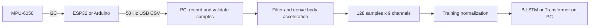

# Hardware setup, wiring, and calibration

This guide covers ESP32 and classic Arduino Uno/Nano sensor acquisition with the MPU-6050. Firmware sketches are included under `hardware/firmware/`. It describes wiring, calibration, telemetry, and the processing required to use these measurements with the BiLSTM and Transformer.

## Components

| Component | Specification | Purpose |
| --- | --- | --- |
| Microcontroller | ESP32 NodeMCU / ESP32-WROOM-32, or classic Arduino Uno/Nano with ATmega328P | Read and stream sensor measurements |
| IMU | MPU-6050 module, such as GY-521 | Three acceleration axes and three angular velocity axes |
| Connections | Jumper wires and breadboard as needed | Power, ground, and I2C |
| USB cable | Data-capable cable matching the board connector | Programming, power, and serial telemetry |
| Mounting | Secure wearable strap | Repeatable sensor position and orientation |

The firmware configures acceleration to +/-2 g and gyroscope to +/-250 degrees/second. Streamed gyroscope values are converted to radians/second. For comparison with smartphone UCI HAR data, document sensor mounting and axis orientation; wrist recordings are a different measurement setting from waist-mounted recordings.

## Wiring

### ESP32

| ESP32 pin | MPU-6050 module pin | Function |
| --- | --- | --- |
| 3V3 | VCC | Module power |
| GND | GND | Common ground |
| GPIO 21 | SDA | I2C data |
| GPIO 22 | SCL | I2C clock |

GPIO 2 is the sketch's status LED. GPIO 19 is mentioned as an optional INT connection in the source comments, but the sketch polls the sensor and does not use an interrupt; four sensor wires are sufficient. The sketch selects I2C address `0x68` and requests a 400 kHz I2C bus.

### Classic Arduino Uno / Nano

| Arduino pin | MPU-6050 module pin | Function |
| --- | --- | --- |
| Supply supported by the actual module | VCC | Module power |
| GND | GND | Common ground |
| A4 | SDA | I2C data |
| A5 | SCL | I2C clock |

Use the voltage and logic levels supported by the actual breakout; a breakout regulator does not by itself establish that its I2C pins tolerate 5 V. Pin 13 is used as the calibration indicator. This sketch directly sets the ATmega328P `TWBR` register and is intended for the classic AVR boards named above.

## Firmware files and upload

| Board | Sketch |
| --- | --- |
| ESP32 | [esp32_har_streamer.ino](../hardware/firmware/esp32_har_streamer/esp32_har_streamer.ino) |
| Arduino Uno/Nano | [arduino_mpu6050.ino](../hardware/firmware/arduino_mpu6050/arduino_mpu6050.ino) |

1. Connect the sensor and board as above.
2. Open the matching sketch in Arduino IDE. Install/select the board support package appropriate to that board. The ESP32 sketch uses the board package's Wire and BLE libraries; the AVR sketch uses Wire.
3. Select the board and its USB serial port, then upload.
4. Keep the sensor still and flat with its positive Z axis pointing upward while startup calibration runs.
5. Open Serial Monitor at **115200 baud**. Wait for calibration to finish and check the numeric CSV lines.
6. Close Serial Monitor before another program opens the same port.

Both sketches estimate gyro zero offsets and accelerometer offsets while preserving approximately +1 g on Z. The ESP32 averages 200 samples with 5 ms delays; the Arduino averages 100 samples with 10 ms delays. These are stationary offset routines, not full six-position sensitivity calibrations. The ESP32 also waits about one second before setup.

## Telemetry format

Both sketches target **50 Hz over USB serial**, one sample every 20 ms:

```text
Ax,Ay,Az,Gx,Gy,Gz,Timestamp_ms
0.01245,0.03412,0.98120,0.00120,-0.00340,0.00085,124850
```

| Fields | Units / meaning |
| --- | --- |
| Ax, Ay, Az | Total acceleration including gravity, in g |
| Gx, Gy, Gz | Angular velocity, radians/second |
| Timestamp_ms | Board millisecond counter |

Startup messages begin with `#`; the ESP32 also emits blank lines. A receiver should skip those lines and accept only seven finite numeric fields. Measure timestamp intervals and record missing samples rather than assuming the requested loop rate was achieved. Restarting the board resets timestamps.

The ESP32 advertises `ESP32-HAR-Streamer` with service UUID `4fafc201-1fb5-459e-8fcc-c5c9c331914b` and characteristic UUID `beb5483e-36e1-4688-b7f5-ea07361b26a8`. Its firmware notifies only every second sample, so **BLE carries 25 Hz**. Use the USB stream for a 50 Hz model input. A BLE receiver and resampling procedure would need separate implementation and validation.

## Connecting measurements to the models



A reference host processing pipeline applies a median filter, a third-order 20 Hz low-pass filter, a 0.3 Hz gravity-separation low-pass filter, and 128-sample windows with a 64-sample step. At 50 Hz these windows cover 2.56 seconds, with a 1.28-second step. This is a reference processing design; its equivalence to the benchmark preprocessing has not been established here.

For this repository, construct channels in exactly this order:

| Indices | Model channels | Derivation from sensor measurements |
| --- | --- | --- |
| 0..2 | body_acc_x, body_acc_y, body_acc_z | Filtered total acceleration minus estimated gravity |
| 3..5 | body_gyro_x, body_gyro_y, body_gyro_z | Gyroscope channels in radians/second |
| 6..8 | total_acc_x, total_acc_y, total_acc_z | Filtered total acceleration, retaining gravity |

Keep gravity estimates separate from total acceleration: the last three model channels must retain gravity. This repository includes firmware and setup documentation. A live serial receiver, host signal processor, and model inference loop still need implementation before live classification is available.

Normalize a correctly constructed `(128, 9)` window using `mean` and `std` from the same `data/processed/dataset.npz` used in training:

```python
import numpy as np

with np.load("data/processed/dataset.npz") as prepared:
    normalized_window = (window - prepared["mean"]) / prepared["std"]
model_input = normalized_window.astype(np.float32)[None, ...]  # (1, 128, 9)
```

`window` above is the derived, unnormalized nine-channel array, not the six raw sensor readings. Do not refit normalization on a live window. Training and evaluation in this repository still use UCI HAR; custom recordings need activity labels, subject IDs, validated preprocessing, and their own held-out evaluation before performance can be reported.

The included microcontroller sketches acquire and transmit samples. Neither runs the BiLSTM or Transformer on the board. No on-device inference timing, model accuracy on physical sensors, or firmware compilation/flashing has been validated in this folder.

## Troubleshooting

| Symptom | Check |
| --- | --- |
| No serial port | Data-capable cable, board driver, and correct selected port |
| Port busy | Close Serial Monitor or another receiver |
| No sensible IMU readings | Common ground, SDA/SCL wiring, sensor power, and address 0x68 |
| Stationary readings have large offsets | Repeat startup calibration with +Z up and the board still |
| Predictions unstable | Units, mounting, channel order, normalization, filtering, and measured sample rate |
