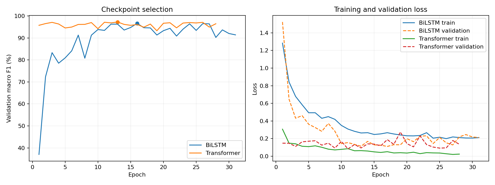

# Full training results

The Transformer achieved the higher held-out test accuracy and macro F1 in these runs.

| Model | Training device | Epochs completed | Best epoch | Test accuracy | Test macro F1 |
| --- | --- | ---: | ---: | ---: | ---: |
| BiLSTM | cuda | 31 | 16 | 89.65% | 89.66% |
| Transformer | cpu | 28 | 13 | 92.81% | 92.65% |

Both runs used robotics with the existing PyTorch 2.10.0+cu130 installation. The Transformer ran on CPU without changing its library or architecture. BiLSTM used the PyTorch implementation on an RTX 3050 6 GB GPU. Its layer layout matches the TensorFlow implementation; shared-weight inference equivalence passed. Framework initialization and training dropout sampling differ.

Protocol: maximum 100 epochs; early stopping after 15 consecutive epochs without improved validation macro F1; checkpoint selection by maximum validation macro F1; Adam learning rate 0.001; batch size 64; seed 42. The selected checkpoints, rather than the final epoch weights, were evaluated.

Data: identical nine-channel UCI HAR preparation, 5,551 training windows, 1,801 validation windows, and 2,947 official test windows. Subjects are disjoint; normalization was fitted on training subjects only. The dataset fingerprint matches for both runs.

These are completed early-stopped runs, not the earlier one-epoch pipeline checks. They are single-seed measurements, so they do not establish statistical superiority across seeds. Training devices differ; this is an accuracy comparison, not a speed benchmark. No physical-sensor or embedded-device performance is claimed.

## Artifacts

- [Training curves](training_curves.png)
- [BiLSTM confusion matrix](bilstm/confusion_matrix.png)
- [Transformer confusion matrix](transformer/confusion_matrix.png)
- [Comparison CSV](comparison.csv)
- [Environment versions](environment.json)
- [Data split manifest](data_manifest.json)

Each model subfolder contains evaluation metrics, per-class reports, confusion matrices, training history, and configuration. Checkpoints and per-sample probabilities remain under the ignored runs folders. comparison.json records checkpoint SHA-256 hashes.

